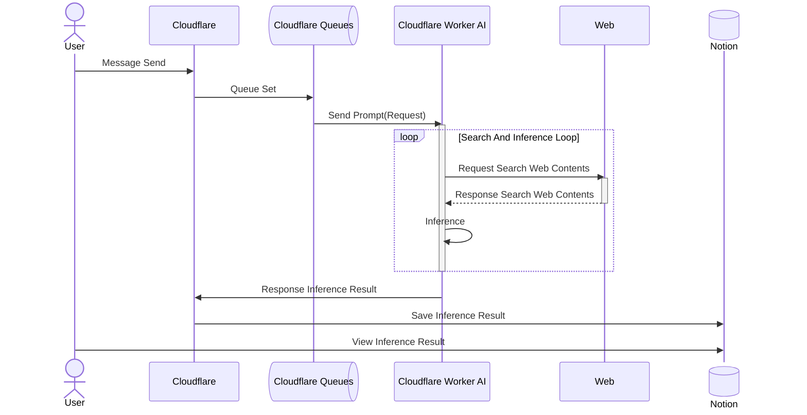

# Netz
AIによる情報収集によるナレッジ収集

## WorkerのWorkflow

## Cloudflareのサービスで使用する予定のもの

- [Queue](https://developers.cloudflare.com/queues/)
    - リクエスト順の管理
- [Workflows](https://developers.cloudflare.com/workflows/)
    - Cloudflare Worker上のLLMでのリクエストの扱いを整える
- [Browser Run](https://developers.cloudflare.com/browser-run/)
    - プログラムによって動的なウェブページや生のHTMLを読み込み、完全にレンダリングし、次のような特定の出力を取得
- [Providers](https://developers.cloudflare.com/web-search/providers/)
    - 検索プロバイダーを用いて検索できる
- [AI Search](https://developers.cloudflare.com/ai-search/)
    - 検索インフラ全体を構築することなく、あらゆるアプリケーションやエージェントに検索機能を追加
- [Agent Memory](https://developers.cloudflare.com/agent-memory/)
    - 話を取り込んでメモリを自動的に抽出したり、アプリケーションが保存すべき情報を既に把握している場合は、明示的に情報を記憶するため
- [Build Agents](https://developers.cloudflare.com/agents/)
    - Cloudflare上でエージェントを構築・ホストし、ブラウザ、サンドボックス、AI検索、MCP、決済、その他のMCPツールを備えた耐久性のあるエージェントランタイムに、チャット、音声、メール、Slack、Webhookを接続