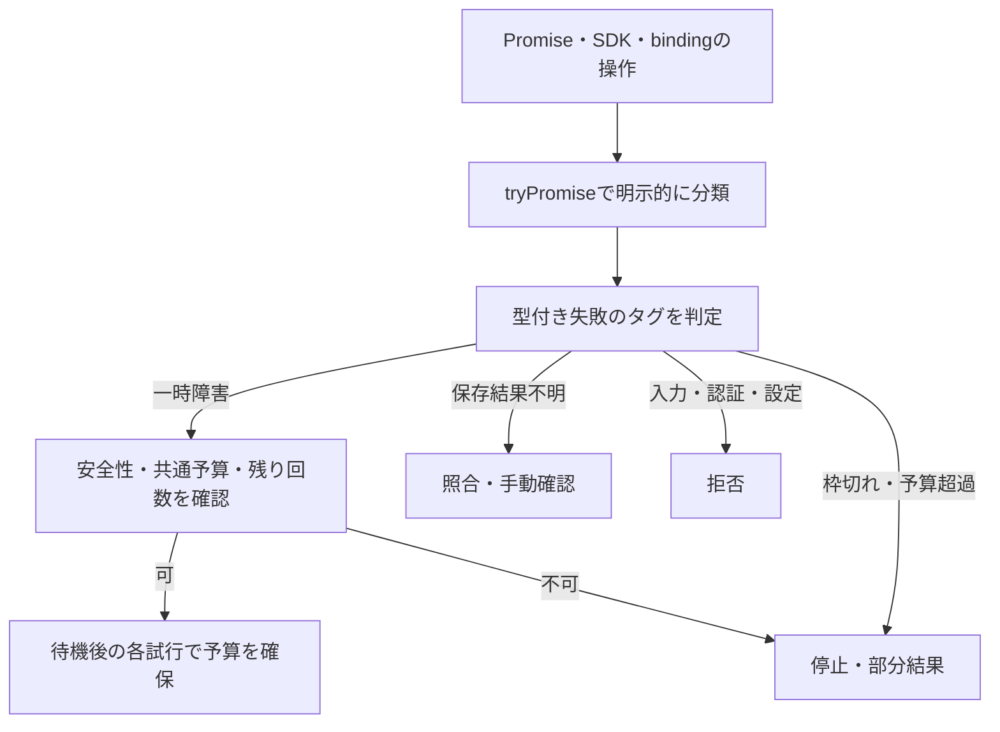

# Effectによるエラー処理

## 導入範囲

`effect@4.1.0` をエラー処理基盤として使用する。現行のfetch/queueはまだテンプレート段階であり、
今回追加する `src/errors.ts` と `src/http-error-boundary.ts` はMVPの実装時に接続する共通部品である。
現行ハンドラーを認証済み・調査実装済み・Effect移行済みと扱わず、このPRを理由に本番公開しない。

ランタイム依存はeffect本体のみ。Effect専用Nodeランタイムや有料サービスは追加しない。
Effectのインメモリ状態・Scheduleは、Cloudflare上での永続実行・共通予算・冪等性を代替しない。
Workers FreeのCPU・メモリ・通信上限への実適合は、実際のハンドラーへ接続後の確認事項として残す。

## 型と回復方針

|エラー|処理|自動再試行|
|---|---|---|
|ConfigurationError|設定不備で拒否|しない|
|AuthenticationError|認証拒否|しない|
|InputValidationError|入力拒否|しない|
|QuotaExhaustedError|quota_exhaustedで停止|しない|
|BudgetExceededError|budget_exceededで停止|しない|
|DependencyUnavailableError|一時障害として回復条件を判定|安全性・残り回数・共通予算を満たす場合だけ|
|PageFetchError|理由を残して当該ページをスキップ|この基盤ではしない|
|SaveOutcomeUnknownError|save_unknownとして照合・手動確認|無条件に再作成しない|

`decideRecovery` は判断を返す純粋関数であり、再試行・ack・保存・予算の永続更新を実行しない。
特に「stopだからack」にはしない。依頼の停止理由と保存状態を確実に記録した後で配送判断する。
書き込みは未反映と上流から確認できた場合のみ再試行候補とする。
タイムアウト・応答喪失だけでは未反映を証明できない。Notionの結果不明は必ず専用エラーへ分類する。
429というステータスだけでは、無料枠切れと一時レート制限を区別できない。プロバイダのエラーコード等で分類する。

## Effectの境界



- 業務処理は `Effect.Effect<成功値, 型付きエラー, 必要な依存>` として合成する。
- 外部Promiseの失敗は `Effect.tryPromise` のcatchでドメインへ変換する。通信操作へAbortSignalを渡し、キャンセルと永続状態を整合させる。
- 想定内の失敗は `Effect.catchTags` 等で必要な種類だけ処理する。defectや中断を成功・completeへ握りつぶさない。
- 実行はfetch / queue / 採用時のWorkflowステップ等の外側で行い、内部関数でrunPromiseを繰り返さない。
- HTTP境界では `runHttpEffect` がExitを評価し、型付き失敗・defect・中断を分ける。返すのは固定コードのみで、message・cause・トークン・上流本文は含めない。
- Queue/WorkflowではHTTP境界を使わず、runPromiseExitの結果を状態記録と個別の再試行・配送判断へ変換する。
- Requestごとの依存・資格情報をグローバルなruntimeやLayerに保持しない。

HTTP境界は将来のAPIへの接続用で、既存の業務契約にある認証401・設定503を維持する。
処理予算は409、外部依存・枠切れ・保存不明は503、取得失敗は502、中断は503、defectは500とする。
これらは未接続の共通部品の応答であり、非同期依頼の状態遷移はresultStatus / stopReason / saveStatusで別に扱う。

## リトライを実装するときの条件

回復判断がretryでも、`Effect.retry` をそのまま全エラーへ適用しない。
永続的な共通予算を各送信前に確保し、Schedule・Queue・Workflow・SDKの多重リトライを防ぐ。
retryAfterMsは短縮せず、不正値は再試行拒否とする。実行環境で待機できない場合は永続的な遅延・再開へ変換する。
固定の最大回数、バックオフ、必要に応じたジッター、キャンセルを採用構成に合わせて実装する。
Effectを追加しても未検証のMCP・AI・Notion実接続が完了したことにはならない。

## 確認

```bash
pnpm typecheck
pnpm test
OPENSPEC_TELEMETRY=0 pnpm dlx @fission-ai/openspec@1.15.0 validate --all --strict --no-interactive
```

テストは無料枠・共通予算・書き込みの安全性・保存不明・型付き回復・Promise拒否・安全なHTTP応答・defect・中断を確認する。
Workers本体の実挙動・永続化・全プロバイダの分類は、MVPの対応タスクで検証する。

## 公式資料

- https://effect.website/docs/v4/error-management/expected-errors
- https://effect.website/docs/v4/error-management/unexpected-errors
- https://effect.website/docs/v4/error-management/retrying
- https://effect.website/docs/v4/getting-started/running-effects
