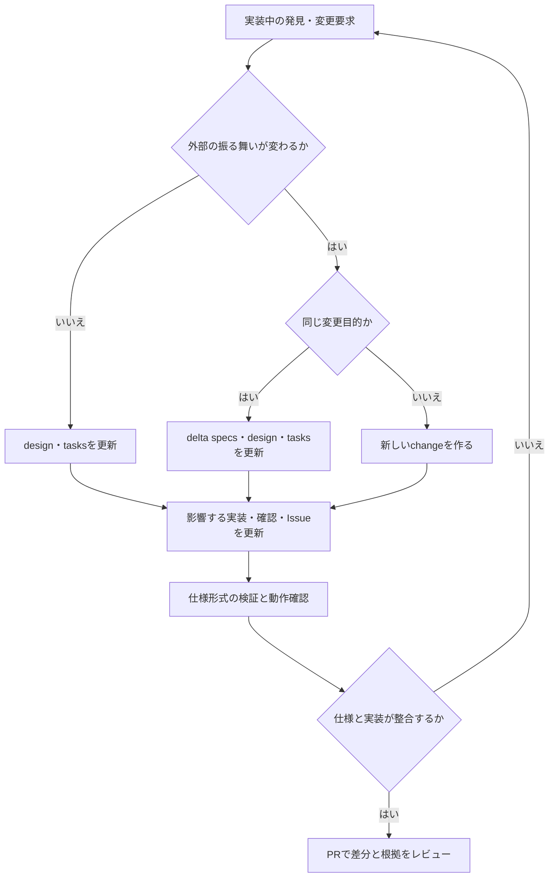

# OpenSpecによる開発と仕様変更

## 導入

pnpm方式を使用する。今回確認したCLIは1.15.0。最新版へ更新する際は生成物と検証結果の差分も確認する。

```bash
pnpm add -g @fission-ai/openspec@latest
openspec --version
```

PATHに入らない場合はpnpmのglobal bin設定を確認する。Nixとの二重導入は不要。
初期化済みのリポジトリでは再初期化は不要。Claude CodeとCodexの公式連携を同梱する。
生成物の更新は `openspec update --dry-run --json` で確認してから `openspec update` を実行する。
生成ファイルを直接カスタマイズせず、プロジェクト固有の指示をconfig.yamlとAGENTS.mdに置く。

## 仕様と進捗の役割

|場所|役割|
|---|---|
|`openspec/specs/<capability>/spec.md`|取り込まれた仕様。実装・実機確認の証明は別途必要|
|`openspec/changes/<change>/proposal.md`|目的・範囲・影響|
|`openspec/changes/<change>/specs/`|作業中の追加・変更・削除要件とシナリオ|
|`openspec/changes/<change>/design.md`|設計判断・検証根拠・採用条件|
|`openspec/changes/<change>/tasks.md`|実装・検証のチェックリスト|
|GitHub Issue / PR|作業管理・受入条件・仕様と証跡へのリンク|

初回changeのimplement-research-workflowはIssue #1〜#7の実装予定。OpenSpecの導入でアプリを実装済みにはしない。
Issueの詳細契約と差分仕様が食い違う場合は、差異を記録して揃えてから該当作業を進める。

## 開発開始

```bash
openspec list --specs
openspec list
openspec status --change implement-research-workflow --json
openspec instructions apply --change implement-research-workflow --json
openspec validate --all --strict --no-interactive
```

Claude Codeでは/opsx:propose、/opsx:apply、/opsx:update、/opsx:sync、/opsx:archiveを使用する。
Codexでは対応するopenspec-propose、openspec-apply-change、openspec-update-change等のスキルを使う。
スラッシュコマンドはシェルコマンドではない。
Coreにはverifyコマンドを含めていないため、シナリオと実装・テスト・実機結果の照合をPRで行う。

## 実装中の細部変更



- 同じ目的のライブラリ選定・処理分割・設計詳細は、既存changeのdesignとtasksに理由・影響・確認方法を記録する。
- API、認証、処理上限、十分条件、失敗時動作が変わる場合は、delta specsとシナリオも同じPRで更新する。
- MODIFIEDは要件全体と既存シナリオを含める。部分上書きで例外条件を失わない。
- 目的が異なる変更や独立して完了できる変更は新しいchangeに分け、依存を記録する。
- 無料・本人専用・証拠付きの十分条件・調査計画承認の要件を細部変更として勝手に緩めない。変更要求がある場合は影響を明示して所有者と決定する。
- 未採用サービスの調査を実機検証済みと扱わない。
- 開発中の仕様変更と、利用者が承認した調査計画の実行中変更を区別する。後者は黙って変更しない。
- 実装差異を見つけたら、仕様を自動的にコードへ合わせず、バグか意図した変更かを判断して記録する。

## 変更の完了

statusのartifact完了はファイルが揃ったことを示し、実装済みを意味しない。
validateは形式検証であり、意味・認証・実接続の正しさを保証しない。

全実装・確認タスクとIssueの受入条件が揃ってから差分を現行仕様へ同期・archiveする。
CLIのarchiveは差分仕様の取り込みも行うため、実行前に変更対象を確認する。

```bash
openspec validate implement-research-workflow --strict --no-interactive
# 実装・検証がすべて完了してから実行
openspec archive implement-research-workflow --yes
openspec validate --all --strict --no-interactive
```

今回はarchiveしない。未完了タスク・外部検証をarchiveで隠さない。

## Issueとの対応

|Issue|capability|
|---|---|
|#1|全体統合|
|#2|cost-and-budget、実行基盤|
|#3|private-research-api、research-planning|
|#4|research-tools|
|#5|research-planning、evidence-research、cost-and-budget|
|#6|notion-reporting|
|#7|全capabilityの統合・障害・再開確認|

Issueはすべて[Netz](https://github.com/UtakataKyosui/Netz/issues)を参照する。
元Issueの詳細な採用基準・検証票は維持する。契約は差分仕様、構成判断はdesign、進捗と証跡はtasksに対応づける。
