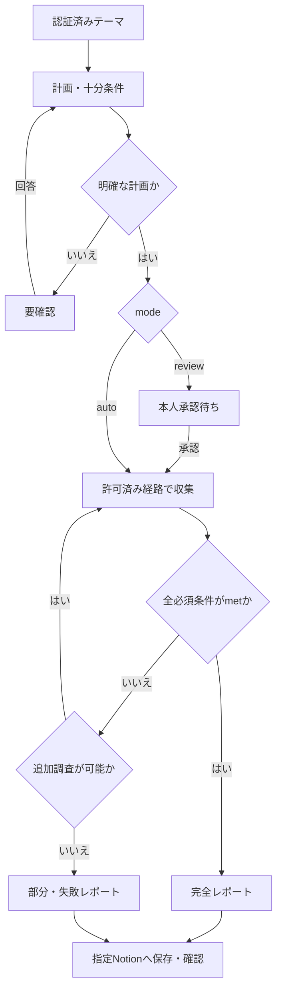

# Design

## Context

要件と対象はproposalおよび6つの差分仕様を参照する。現行コードはリクエスト情報をQueueに送りConsumerでログ出力する段階であり、調査・認証・保存・再開の実装は未完了。
OpenSpecのartifactが揃うことと、下記の採用判断・実機検証の完了を区別する。

## Goals / Non-Goals

- 実装を「受付」「計画」「収集」「判定」「レポート」「保存」の責務に分け、変更の影響を局所化する。
- LLMの判断とアプリが強制する認証・許可・予算・保存制御を分ける。
- Cloudflare Workflowsサービスや複数エージェントの使用を前提条件にしない。

## Decisions

### 1. 業務状態と保存結果を独立して保持する

requestIdを基準とする。計画は版を持ち、条件・承認・使用済み予算・証拠・判定を永続状態へ保持する。
resultStatus / stopReason / saveStatusを分ける。Queueの配送完了だけでは調査・保存完了と判定しない。

### 2. ツールを業務操作へ対応づける

Netzは任意のMCPツールを直接モデルへ公開せず、search / fetchPage / 資料参照などの制約付き操作へ対応づける。
Portalはツール集約・認証、Netzは計画・引数検証・共通予算・証拠管理を担当する。
Tavilyを採用する場合はbasic固定とし、extract/crawl/map/researchを自動利用しない。
MCP未設定時は計画に記載した許可済み無料直接経路のみ利用できる。障害時の無断迂回はしない。

### 3. 条件と証拠を照合する

criterionのmet / unmet / unknownと、問いのanswered / insufficient / conflicting / not_researchedを区別する。
LLMの評価理由を証拠へ対応づけ、必須項目・参照整合性・上限はアプリで検証する。
技術仕様は一次情報を優先し、本文確認や独立した複数出典が必要なら計画時に明示する。

### 4. 初期予算を依頼単位で管理する

|操作|上限|含めるもの|
|---|---:|---|
|検索|3回|全MCP・直接経路・失敗・再試行|
|本文取得|5ページ|資料参照で実際に本文取得する分・再試行|
|推論|4回|計画・修正・不足評価・JSON修正・最終整理・再試行|

送信前に予算を確保し、同時実行・再開で初期化しない。推論は計画1回、不足評価最大2回、最終整理1回を標準配分とする。
計画修正で使えば後続を減らす。推論予算ゼロでは台帳からテンプレートで部分・失敗レポートを生成する。

### 5. 保存は専用処理で制御する

Notion保存はモデルの任意ツール呼び出しにしない。保存先はサーバー設定、requestIdとpage IDを対応づける。
同時作成を防ぎ、ページ作成・本文追記後の応答喪失を照合する。未確定はsave_unknownで停止し、即時再作成しない。

### 6. Effectによる失敗の分類と境界

Effect 4.1.0の型付きエラー・回復判断・HTTP境界を共通基盤として使う。詳細はdocs/error-handling.md。
外部PromiseはアダプターでtryPromiseへ変換し、枠切れ・一時制限・結果不明を明示的に分類する。
共通基盤の導入では既存fetch/queueを移行済みとしない。永続状態を更新した後に配送を判断し、SDK/Effect/Queue/Workflowの多重リトライを防ぐ。
runPromiseExitは実行境界で使い、defect・中断を成功やcompleteへ握りつぶさない。

## Adoption Gates

以下は実装前に根拠を記録する必要がある判断ゲート。現時点では未決・未検証であり、依存するタスクを実装完了にしない。

|ゲート|確認内容|担当Issue|
|---|---|---|
|実行・永続化|Consumer完結かWorkflows Freeか、計画保持・期限・排他・再開・予算の永続化が無料で成立する方式|#2 #5|
|MCP|既存ドメイン、Portal認証、無料条件、単体・複数ツールの実Workers確認|#4 #7|
|推論モデル|無料対象・日本語品質・function calling・消費と応答の実測|#5|
|具体的上限|入力文字/バイト、応答/本文量、トークン、時間、保持期限、資料参照等のツール予算|#3 #4 #5|
|Notion|現行SDKとdatabase/data sourceの対応、スキーマ、制限、保存結果不明の照合・回復|#6|

Qwen3-30B-A3B、Tavily Freeは候補。契約・権限・実機結果を確認して初めて採用する。
ゲートで構成が決まったら、このdesignとtasksを更新する。外部挙動が変わる場合は差分仕様も更新する。
不適合なら機能縮小・構成見直しとし、有料化で解決しない。

## Risks / Trade-offs

- 無料CPU・保存枠に収まらない → 本文量・処理分割・保持量を縮小して再検証。
- MCPのツール名・認証・スキーマ変更 → 採用情報を版管理し、不明な対応は停止・再検証。
- LLMが根拠を誤解する → 出典参照・条件評価を保存し、シナリオと期待する証拠を照合。
- Notion側の作成結果を断定できない → 自動回復できないケースでは手動確認待ちを許容。
- OpenSpecの形式検証は挙動を保証しない → 動作試験・外部実測の証跡を別に管理。

## Migration Plan

OpenSpec導入PRではランタイムを変更しない。MVP実装はtasksの順に進め、該当ゲート解決前に依存機能を実装済みと扱わない。
仕様差分・設計・タスクとIssueの対応をPRで確認し、実装・確認が完了した変更だけsync/archiveする。
